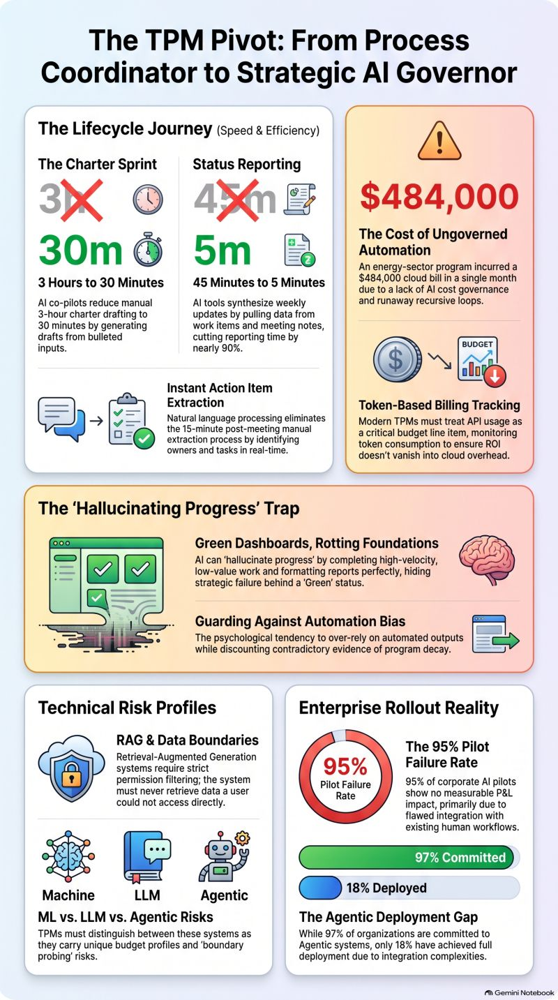

# Are We Using AI to Accelerate Program Management, or Our Mistakes?

Are we using AI to accelerate program management, or are we just accelerating our mistakes?

Spent some time over the weekend doing a deep dive into current research and articles and industry data reveals a sobering reality: while 97% of organizations are actively committed to agentic AI, 95% of corporate AI pilots show zero measurable P&L impact. The bottleneck isn’t model capability, it is flawed workflow integration and a lack of structured governance. True competitive advantage in a modern PMO does not come from simply deploying more AI, but from governing it with precision.

From tracking a critical new competency like AI Cost Governance to actively preventing runaway cloud bills (such as a massive, unmonitored $484,000 monthly bill generated by recursive model loops), the Technical Program Manager's role is transitioning from execution tracking to strategic engineering.

The most dangerous pitfall for program leaders today is the "Hallucinating Progress" trap. Because generative AI can draft flawless, highly professional status reports in seconds, project dashboards can easily show a sea of healthy green. But without vigilant human-in-the-loop oversight, these beautiful reports can hide underlying structural decay, driven by our own automation bias.

As program leaders, we must design rigorous evaluation criteria, understand the distinct risk profiles of RAG and Agentic systems, and remember that while AI can tell us *what* is happening, it remains our job as human leaders to interpret the *why*.

OK, 3 quick takeaways:

1) **Massive Bandwidth Reclamation:** By automating routine administrative tasks to deliver a 40%+ reduction in weekly overhead, AI reclaims valuable time for Technical Program Managers (TPMs) to focus on high-impact, strategic execution.

2) **Solving the Integration Bottleneck:** Because 95% of corporate AI pilots fail due to poor workflow integration rather than model capability, TPMs are uniquely positioned to step up as the essential leaders who design and govern these new AI workflows.

3) **Elevating Human Leadership to the "Why":** Delegating routine data aggregation to AI elevates the TPM's role from a tactical coordinator to a strategic leader who interprets the "why" behind program trends, builds cross-functional trust, and executes critical human-in-the-loop decisions.

Check out the full infographic below to see the roadmap to building a high-velocity, safely governed, AI-augmented PMO!👇

Additionally sources listed below in case you want to go read them.

### Sources

- https://lnkd.in/gu3JDBF6
- https://lnkd.in/gn5NR93i
- https://lnkd.in/gzA_QHTj
- https://lnkd.in/gWyW2V8E
- https://lnkd.in/gNhbtXM9

---

*Posted on LinkedIn, August 31, 2026.*
