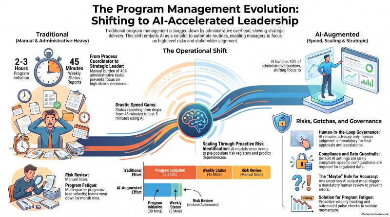

# The Program Management Evolution: AI as an Embedded Co-Pilot

Traditional program management is bogged down by manual overhead. AI as an embedded co-pilot changes the math:

- Program initiation: 2-3 hours to 30 minutes
- Weekly status reports: 45 minutes to 5 minutes
- Risk review: manual scan to instant/automated

AI now handles roughly 40% of administrative burden. That's the shift from process coordinator to strategic leader: less time on paperwork, more on cross-functional dependencies, risk identification, and stakeholder alignment. AI models scanning trends to pre-populate risk registers and predict dependencies is what makes the scaling work, not just faster typing.

Governance is the non-negotiable part:

- **Human-in-the-loop:** AI stays advisory. Final approvals and escalations require human judgment, full stop.
- **Compliance and data guardrails:** default AI settings are rarely compliant. Regulated data needs specific configuration, not the out-of-box setup.
- **The "maybe" rule:** any uncertain AI output triggers mandatory human review. No exceptions for convenience.
- **Program fatigue:** multi-quarter programs lose velocity, usually by month nine. Proactive tracking and automated pulse checks are the fix, not more meetings.

The gains are real, but they only hold up if the guardrails are built in from the start, not bolted on after something breaks.

What's your take on everything? Where are the bumps in the road and what are some of your favorite sites, blogs and skills that have helped you?

---

*Posted on LinkedIn, August 29, 2026.*
