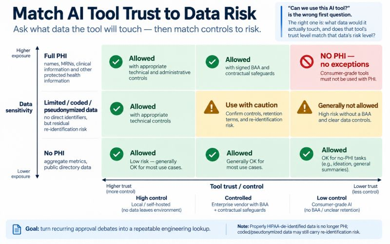

# Match AI Tool Trust to Data Risk

"Can we use this AI tool?" is the wrong question in a healthcare product. The right one: what data would it actually touch, and does the tool's trust level match that data's risk level?

That's the matrix I built at Talamel. Two axis.

Data sensitivity, low to high: no PHI, de-identified/coded reference, full PHI.

Tool trust, low risk to high: local/self-hosted with nothing leaving our environment, enterprise vendor with a signed BAA, consumer-grade tool with no BAA and unclear retention.

Cross them and "can we use this tool for this task" stops being a debate. It's a lookup. Full PHI only ever meets local or BAA'd vendor tools. Never consumer tier. No exceptions, no "just this once." No-PHI tasks can use almost anything, which is why our architecture runs on live pointers to upstream data instead of local copies. It keeps more day-to-day work in that permissive bottom-left cell by design.

The real unlock isn't the matrix. It's that engineers stop asking legal and me the same question every week. They check the grid and move.

If you're building AI into a regulated product: what's the one data category you're most nervous about a tool touching?

---

*Posted on LinkedIn, September 14, 2026.*
