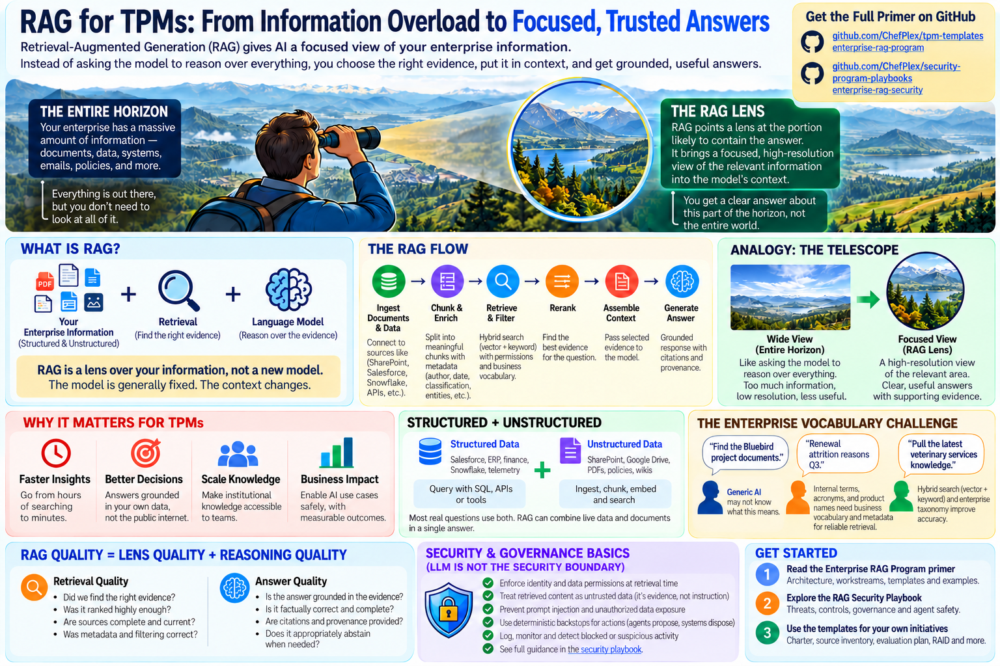

# RAG for TPMs: Think of It as a Lens

### Understanding Retrieval-Augmented Generation without getting lost in the technology

I've been spending time learning AI architecture, particularly Retrieval-Augmented Generation, or RAG. One explanation kept coming up:

**"RAG connects a large language model to a vector database."**

Okay. But what does that actually mean? What changes inside the model, and why would a company pay for it?

Coming from a technical program management and security background, I wanted to understand the architecture, not just memorize the terms. After working through a few examples, one analogy made it click.

## RAG is a lens over your information

Imagine standing on a hill overlooking an enormous landscape. That landscape is everything your company knows: Salesforce records, financials, SharePoint, Google Drive, product documentation, support tickets, engineering designs, policies, and thousands of other sources. You can see the whole horizon. You can't examine every detail at once.

Now pick up a telescope and point it at one valley. Suddenly you're looking at a much smaller piece of the landscape, in far more detail.

That's how I think about RAG. It narrows what the AI model sees to what's likely to matter for one question. The telescope doesn't create a new landscape, and RAG usually doesn't create a new language model.

**The model stays largely the same. The context changes.**

The analogy comes with a warning. A telescope can give you a perfectly clear view of the wrong valley. Retrieval can too: it can hand the model information that looks highly relevant and still doesn't answer the question. Hold on to that one. It's where most of the design and evaluation work lives.

## So where does the model come from?

This was one of my first questions. Are we building a model, training one, or using one that already exists?

Usually the last. It's an existing model from OpenAI, Anthropic, Google or another provider, and what we build is everything around it. A typical flow:

**Information sources → Ingestion → Chunking and metadata → Retrieval → Reranking → Context assembly → LLM → Answer**

RAG is an architectural pattern that connects retrieval to generation. Nobody installs it out of a box. For a TPM, the point is that every stage in that line has its own decisions, dependencies, risks and quality measures.

## Vector search: a map of meaning

*Vector search* threw me at first. My mind went straight to physics: a vector has magnitude and direction.

In AI, a better mental model is a **map of meaning**. An embedding model turns text into lists of numbers called vectors, and text with similar meaning lands close together in that space. Take these two:

"Cancel my subscription."

"Terminate my service agreement."

Almost no words in common. Same intent. Vector search can find one when you ask for the other, because it matches on meaning instead of only on words.

## Enterprise vocabulary changes everything

Now picture a company with thousands of internal terms, acronyms, product names and project codenames. Let's say there's something called **Project Bluebird**.

Outside the company, that name means almost nothing. Inside, it might be a multiyear modernization touching 15 systems. A general-purpose embedding model won't know that.

This is where enterprise enrichment earns its keep. A strong retrieval system combines semantic search with keyword search, business glossaries, aliases and metadata. That's usually called **hybrid search**, and it's where a lot of the enterprise value shows up.

Indexing the documents is the easy half. Teaching the system the company's own language is the work.

## Think of chunks as knowledge cards

You generally don't want to feed whole documents into every AI request, so documents get split into smaller pieces called chunks. I prefer to think of a chunk as a **knowledge card**: a piece of information plus the facts about it.

Who wrote it? When? Which department owns it? Is it the current version? Which project does it reference? Who is allowed to see it? Those facts are the metadata.

Here's why it matters. Someone asks about the refund policy. Retrieval finds a highly relevant paragraph from a policy written in 2020, but there's a replacement policy from 2026. Without good metadata and retrieval logic, the 2020 version can win.

So chunking is more than picking 512 or 1,024 tokens. It's deciding how much context has to travel with each piece for retrieval to find the right one.

## Retrieval finds the neighborhood; reranking picks the house

Say the first search returns 50 candidate pieces of information. Some are relevant. Others only partly match. A reranker scores those candidates more carefully against the actual question and keeps the best few.

**Retrieval gets you into the right neighborhood. Reranking picks the right house.**

The model only ever sees that short list. That's why the retrieval architecture matters as much as the model does.

## Not everything needs to become a vector

Suppose a CEO asks: **"Why did our enterprise renewals decline last quarter?"**

The renewal numbers come from Snowflake, through SQL. The account notes, customer complaints, support documentation and win/loss analyses come through document search. The AI gets both kinds of evidence and helps explain what happened.

Structured numbers and unstructured documents can take different paths to the same answer.

## Why TPMs should care

A RAG program succeeds or fails on things nobody buys from a vendor. Someone has to know where the sources are and who owns them, how the pieces depend on each other, and whether operations is ready to run it. That's a TPM's job.

A TPM should be asking:

- Do we have the right sources, and who owns them?
- How current does the information need to be?
- Do we understand the organization's internal vocabulary?
- How should documents be chunked and enriched?
- Are we retrieving the right evidence?
- Can we tell retrieval failures from model failures?
- Are permissions enforced before information reaches the model?
- How will we measure answer quality and business value?

And one security principle sits above the rest:

**Retrieved content is evidence, not instruction.**

The model can interpret what it retrieves, but permissions and consequential actions need controls enforced outside it. The LLM isn't the security boundary.

## The bigger takeaway

The most useful shift for me was to stop treating RAG as a mysterious new kind of model. It's an architecture for choosing evidence and handing it to a model that already exists. That changes how you evaluate it.

"Did the AI give a good answer?" is the second question. The first one is:

**Did we point the lens at the right information?**

A great model looking through the wrong lens will still give you a polished answer, built on the wrong evidence. Getting the right information in front of the model is the part a TPM can actually fix.

---

### Enterprise RAG resources

I've been building two GitHub playbooks that turn these ideas into a working program.

**[Enterprise RAG Program - TPM Templates](https://github.com/ChefPlex/tpm-templates/tree/main/enterprise-rag-program)**

Program charter, architecture, source inventory, evaluation planning, governance, and delivery guidance.

**[Enterprise RAG Security - Security Program Playbooks](https://github.com/ChefPlex/security-program-playbooks/tree/main/enterprise-rag-security)**

Security architecture, authorization, prompt injection, governance, and operational controls.

If you're running a RAG program now, the source inventory template is the place to start.

---

*Posted on LinkedIn, October 12, 2026, as a shorter version.*
